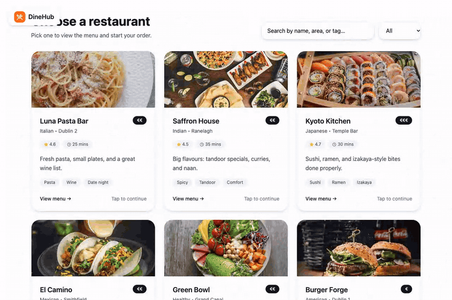
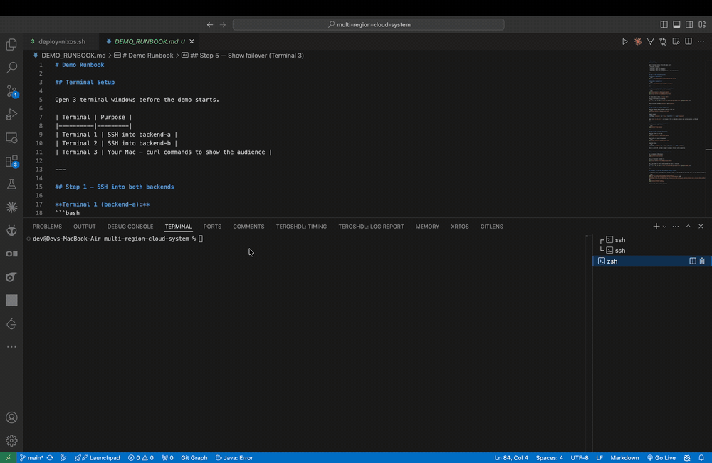
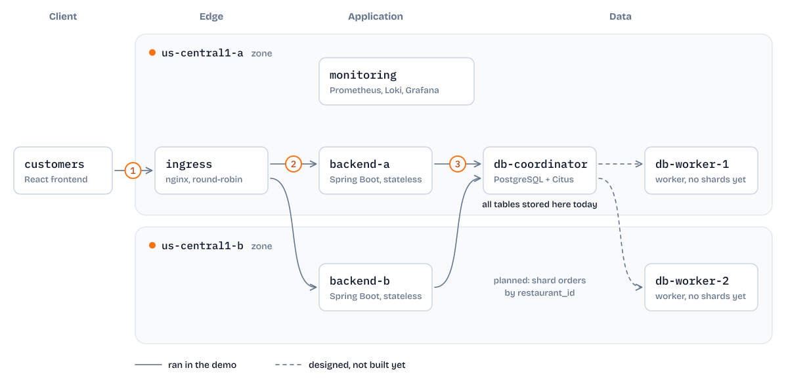
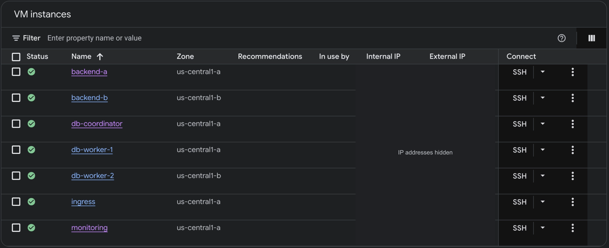
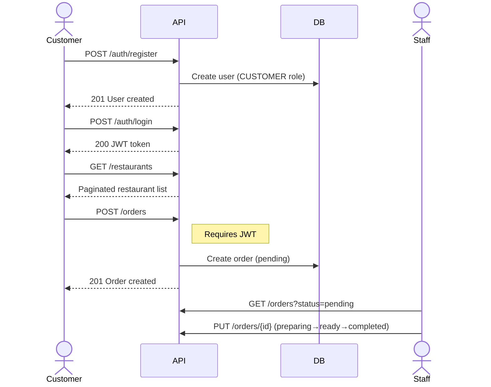
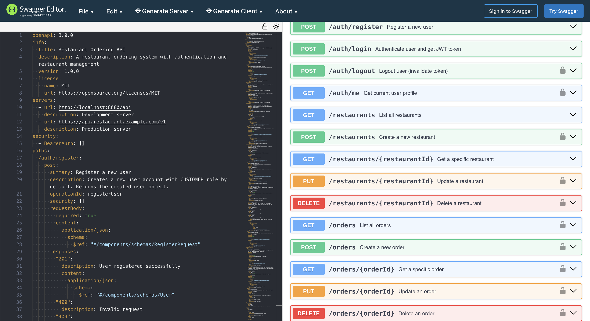
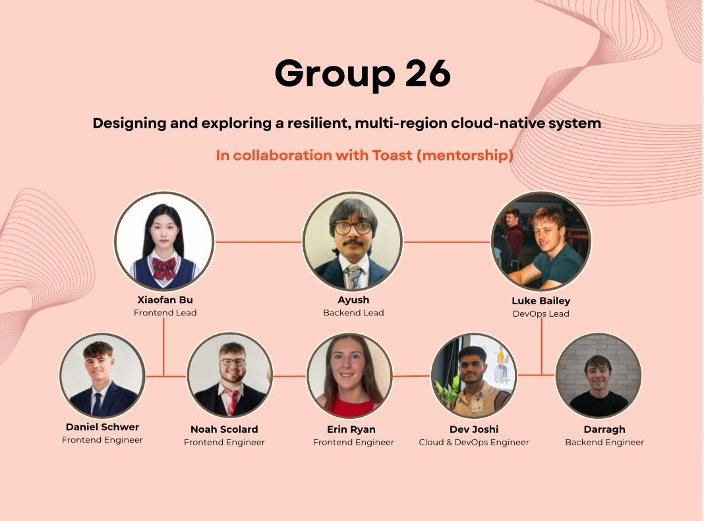

<p align="center">
  <picture>
    <source media="(prefers-color-scheme: dark)" srcset="docs/media/banner-dark.svg">
    
  </picture>
</p>

<p align="center">
  What happens to a restaurant order when a backend goes offline?
</p>

<p align="center">
  <a href="#ordering-demo">Ordering demo</a> ·
  <a href="#failover">Failover</a> ·
  <a href="#architecture">Architecture</a> ·
  <a href="#rest-api">REST API</a> ·
  <a href="#my-role">My role</a> ·
  <a href="#team">Team</a> ·
  <a href="#run-locally">Run locally</a>
</p>

---

Our team built a React ordering interface and a Spring Boot service to explore that question. We designed for multiple regions and tested backend failover on seven Google Cloud VMs spread across two zones in `us-central1`.

A Trinity College Dublin Software Engineering project by Group 26, mentored by Toast.

| Layer          | Built with                                                                     | Code                                                                                                               |
| -------------- | ------------------------------------------------------------------------------ | ------------------------------------------------------------------------------------------------------------------ |
| Frontend       | React 19, TypeScript, Tailwind CSS, Bun                                        | [`frontend/`](frontend)                                                                                            |
| Backend        | Java 25, Spring Boot 4, Spring Security with JWT, JPA                          | [`backend/`](backend)                                                                                              |
| Database       | PostgreSQL with Citus: one coordinator, two workers                            | [`db-coordinator.nix`](nix/nixos-modules/db-coordinator.nix)<br>[`db-worker.nix`](nix/nixos-modules/db-worker.nix) |
| Infrastructure | NixOS flakes, nginx ingress, Tailscale mesh modules, ragenix-encrypted secrets | [`nix/`](nix)                                                                                                      |
| Monitoring     | Prometheus, Loki, Grafana                                                      | [`monitoring-node.nix`](nix/nixos-modules/monitoring-node.nix)                                                     |
| Testing        | Schemathesis contract tests, NixOS VM tests                                    | [`nix/checks/`](nix/checks)                                                                                        |

<a name="frontend-demo"></a>

## Ordering demo

<p align="center">
  
</p>

Search for **Luna Pasta Bar**, open its menu, add a dish, and review the cart. The frontend uses a sample Dublin catalogue and keeps the cart in browser state. [See the full restaurant browser](docs/media/restaurants.png).

<a name="backend-failover-demo"></a>

## Failover

Requests through nginx reach both backends. After the backend service on one VM stops, the ingress health check still returns `UP`, and the next request shows which backend is answering.

```console
$ for i in {1..6}; do curl -s http://$INGRESS/api/server-info | grep hostName; done
{"hostName":"backend-a","os":"Linux","startTime":"2026-04-01T12:24:24.247451672Z","user":"backend"}
{"hostName":"backend-b","os":"Linux","startTime":"2026-04-01T12:27:15.525025368Z","user":"backend"}
{"hostName":"backend-a","os":"Linux","startTime":"2026-04-01T12:24:24.247451672Z","user":"backend"}
{"hostName":"backend-b","os":"Linux","startTime":"2026-04-01T12:27:15.525025368Z","user":"backend"}
{"hostName":"backend-a","os":"Linux","startTime":"2026-04-01T12:24:24.247451672Z","user":"backend"}
{"hostName":"backend-b","os":"Linux","startTime":"2026-04-01T12:27:15.525025368Z","user":"backend"}

[admin@backend-b:~]$ sudo systemctl stop backend

$ curl http://$INGRESS/actuator/health
{"groups":["liveness","readiness"],"status":"UP"}

$ curl http://$INGRESS/api/server-info
{"hostName":"backend-a","os":"Linux","startTime":"2026-04-01T12:24:24.247451672Z","user":"backend"}
```

Output copied from the recorded run on Google Cloud, with the ingress address replaced by `$INGRESS`.

<details>
<summary>Watch the full recording (3 min 8 sec)</summary>
<br>

<p align="center">
  
</p>

At **1:00**, repeated requests through nginx show both backend hostnames. Around **2:00**, after one backend service stops, the ingress health check returns `UP`. The next request shows which backend is answering.

</details>

<a name="system-architecture"></a>

## Architecture

<p align="center">
  <picture>
    <source media="(prefers-color-scheme: dark)" srcset="docs/media/architecture-dark.svg">
    
  </picture>
</p>

A request takes three hops:

1. The browser sends it to nginx on the ingress VM.
2. nginx passes it to `backend-a` or `backend-b` in turn. If a backend errors, times out, or returns 502 or 503, nginx retries on the other one. This is what the failover demo shows.
3. The backend keeps no session state. It validates the JWT on the request, then reads and writes through the PostgreSQL **Citus coordinator**.

Both workers are registered with the coordinator, but no tables are distributed yet, so all data sat on the coordinator in the demo. The design is to shard `orders` by `restaurant_id`. Prometheus, Loki, and Grafana run on a separate monitoring node.

On Google Cloud, I placed a backend and a database worker in each zone. Zone A also hosted ingress, the coordinator, and monitoring.

### Limits and next steps

- **Single points of failure.** The ingress and the coordinator each run on one VM in zone A. Next: a second ingress behind a cloud load balancer, and a standby coordinator in zone B.
- **No sharding yet.** Next: distribute `orders` by `restaurant_id` and make `restaurants` a reference table.
- **One region.** Both zones are in `us-central1`. Serving from two regions would also need the database replicated between them.

<details>
<summary>See all seven instances running in the Compute Engine console</summary>
<br>

<p align="center">
  <a href="docs/media/gcp-nodes.png"></a>
</p>

</details>

[Node definitions](nix/nodes.nix) · [Ingress retry policy](nix/nixos-modules/nginx-ingress.nix) · [Architecture notes](docs/src/infrastructure/architecture.md) · [Original multi-region design](docs/media/backend-architecture.png)

## REST API

The API defines **14 operations** for authentication, restaurants, and orders. The diagram follows a customer from registration to checkout, then shows how staff retrieve pending orders and update their status.



<details>
<summary>View the OpenAPI specification in Swagger Editor</summary>
<br>

<p align="center">
  <a href="docs/media/openapi.png"></a>
</p>

</details>

[Explore the interactive reference](https://editor.swagger.io/?url=https%3A%2F%2Fraw.githubusercontent.com%2FDevEnjoysMath%2Fmulti-region-cloud-system%2Fmain%2Fspecs%2Fopenapi.yaml) · [OpenAPI YAML](specs/openapi.yaml) · [Contract tests](nix/checks/health.nix)

## My role

**Dev Joshi, Cloud & DevOps Engineer**

| Area        | What I did                                                                                                                   | Code                                                                                        |
| ----------- | ---------------------------------------------------------------------------------------------------------------------------- | ------------------------------------------------------------------------------------------- |
| Database    | Worked on the distributed PostgreSQL configuration and documented how the coordinator and workers fit into the architecture. | [Implementation](https://github.com/DevEnjoysMath/multi-region-cloud-system/commit/21f94ea) |
| Credentials | Integrated encrypted database credentials into service startup so PostgreSQL could apply them after it was ready.            | [Database module](nix/nixos-modules/postgres-service.nix)                                   |
| Monitoring  | Added a VM test that starts Prometheus, Grafana, and Loki together and checks their services and ports.                      | [Monitoring test](nix/checks/monitoring.nix)                                                |

<a name="team-and-contributions"></a>

## Team

<p align="center">
  <a href="docs/media/team.jpg"></a>
</p>

<details>
<summary>Explore all eight contributors and their work</summary>
<br>

| Contributor   | Project role            | Selected work                                                                                                                                          |
| ------------- | ----------------------- | ------------------------------------------------------------------------------------------------------------------------------------------------------ |
| Xiaofan Bu    | Frontend Lead           | [Scaffolded the login and signup components](https://github.com/DevEnjoysMath/multi-region-cloud-system/commit/5d0f0f8).                               |
| Ayush         | Backend Lead            | [Implemented JWT-based signup and login](https://github.com/DevEnjoysMath/multi-region-cloud-system/commit/ce09ec6).                                   |
| Luke Bailey   | DevOps Lead             | [Packaged Schemathesis for API testing](https://github.com/DevEnjoysMath/multi-region-cloud-system/commit/b485b15).                                    |
| Daniel Schwer | Frontend Engineer       | [Added photos to the restaurant browser](https://github.com/DevEnjoysMath/multi-region-cloud-system/commit/77361f3).                                   |
| Noah Scolard  | Frontend Engineer       | [Connected the frontend routes and added page transitions](https://github.com/DevEnjoysMath/multi-region-cloud-system/commit/fe2c574).                 |
| Erin Ryan     | Frontend Engineer       | [Built the menu, cart, and checkout UI](https://github.com/DevEnjoysMath/multi-region-cloud-system/commit/a01f4d9).                                    |
| Dev Joshi     | Cloud & DevOps Engineer | [Added distributed PostgreSQL and documented the architecture](https://github.com/DevEnjoysMath/multi-region-cloud-system/commit/21f94ea).             |
| Darragh       | Backend Engineer        | [Implemented the restaurant and order APIs with JPA and integration tests](https://github.com/DevEnjoysMath/multi-region-cloud-system/commit/cab0410). |

</details>

## Run locally

Install [Nix](https://github.com/DeterminateSystems/nix-installer) with flakes enabled. On Windows, use [NixOS-WSL](https://github.com/nix-community/NixOS-WSL). On Coder, run `./scripts/setup-coder.sh` from the checkout first.

```bash
git clone https://github.com/DevEnjoysMath/multi-region-cloud-system.git
cd multi-region-cloud-system
nix develop
nix run .#compose
```

Process Compose starts the Bun frontend, Spring Boot backend, and PostgreSQL database. Open the URL printed by the frontend process and visit `/dashboard` to follow the recorded walkthrough.

| Command                | Purpose                                                                                                        |
| ---------------------- | -------------------------------------------------------------------------------------------------------------- |
| `nix fmt`              | Apply the repository formatters before pushing.                                                                |
| `nix flake check -L`   | Build the frontend and backend, run tests and VM checks, and check formatting.                                 |
| `nix run .#docs.serve` | Serve the project documentation locally, including generated JavaDoc, TypeDoc, and OpenAPI reference material. |

When dependencies change, regenerate the relevant Nix lock data with `bun2nix -o bun.nix` in `frontend/` or `gradle2nix` in `backend/`. [Browse the project documentation in this repository](docs/src/SUMMARY.md).

---

<p align="center">
  Released under the <a href="LICENSE.md">MIT License</a>.
</p>
