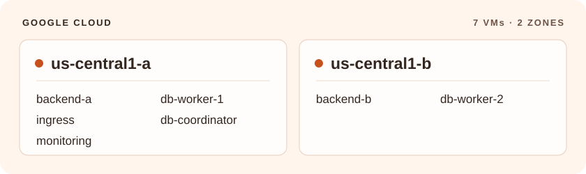
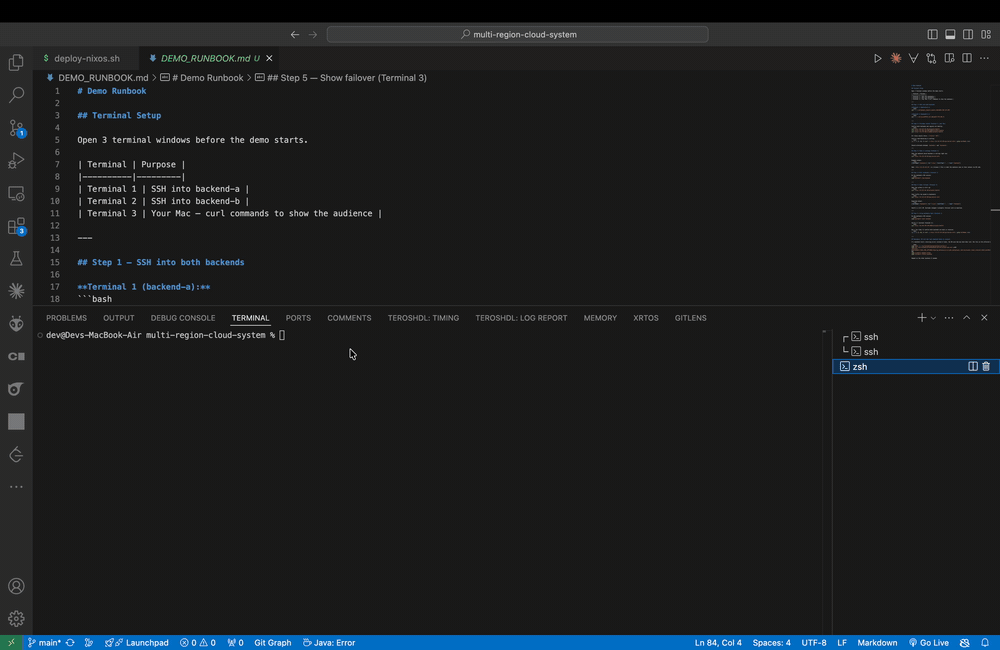
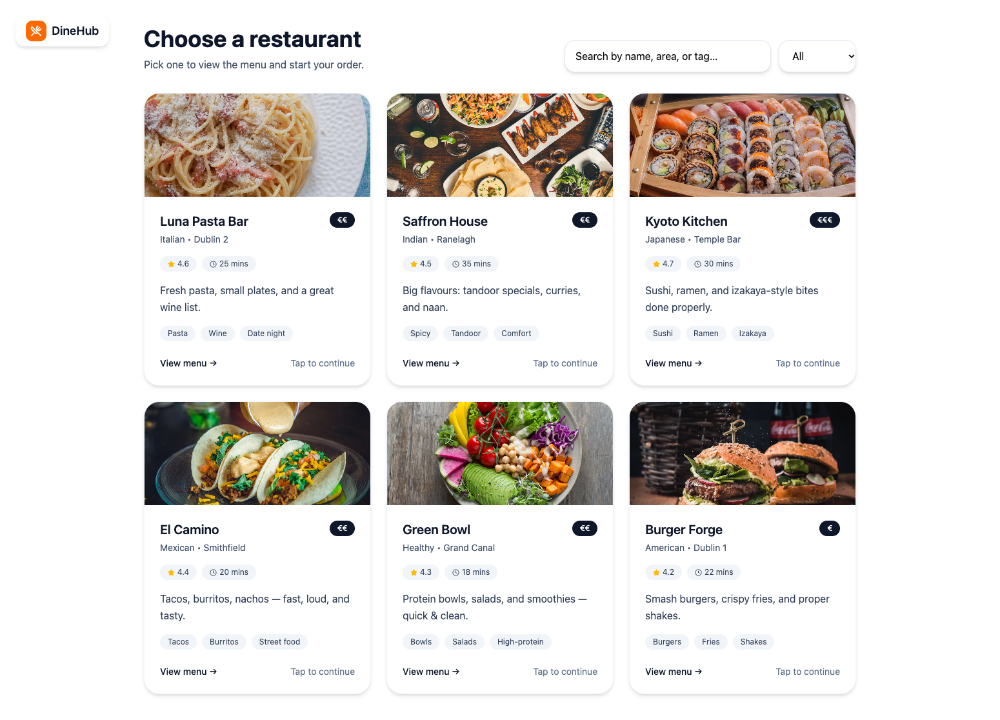
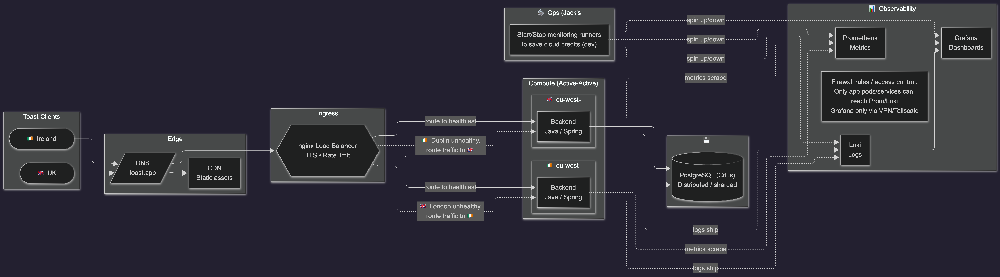
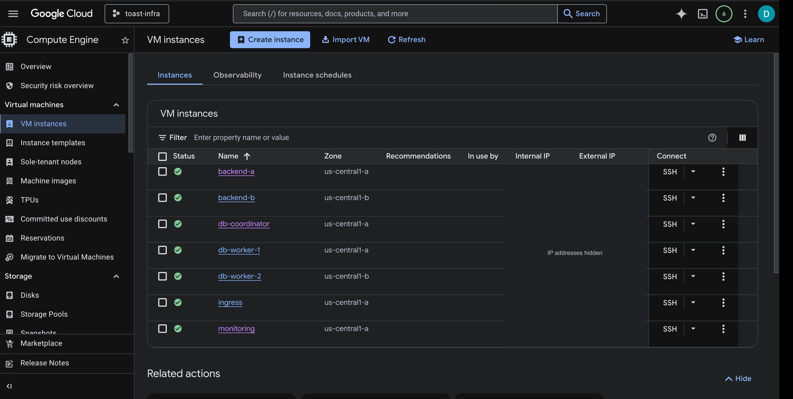
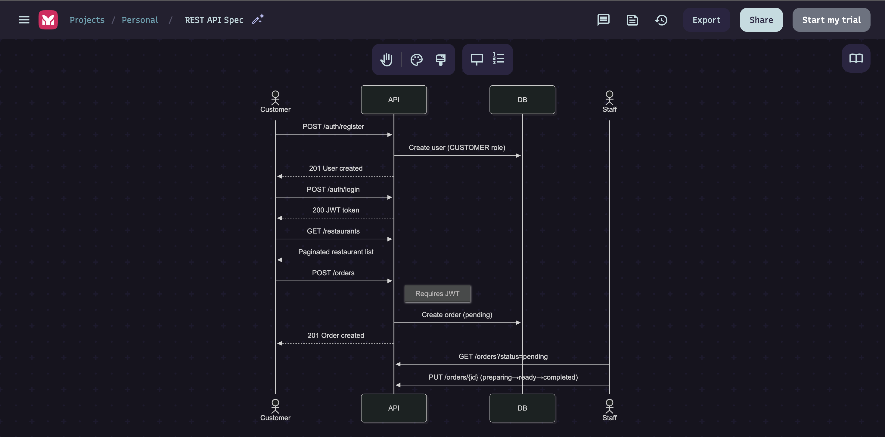
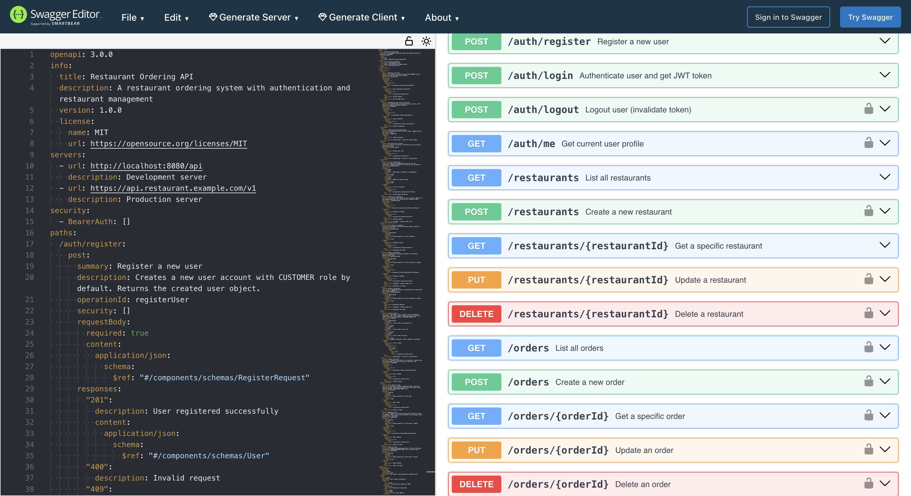
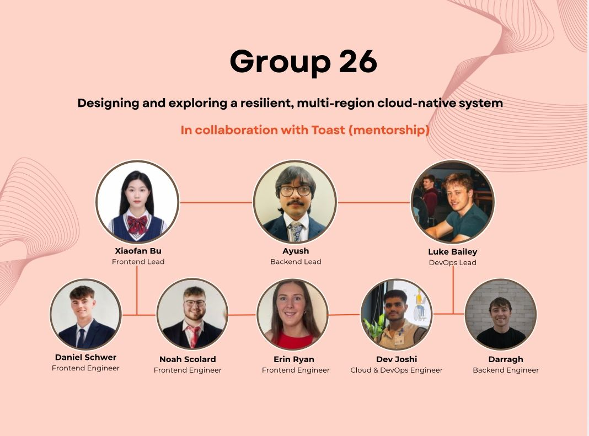

<h1 align="center">🍞 Toast</h1>

<p align="center">
  <strong>Multi-region restaurant ordering</strong><br>
  Trinity College Dublin · Group 26 · Mentored by Toast
</p>

<p align="center">
  <a href="#demos">Demos</a> · <a href="#architecture">Architecture</a> · <a href="#rest-api">REST API</a> · <a href="#my-role">My role</a> · <a href="#team">Team</a> · <a href="#run-locally">Run locally</a>
</p>

---

## About

What happens to a restaurant order when a backend goes offline? Our team built a React ordering interface and a Spring Boot service to explore that question. We designed for multiple regions and tested backend failover on seven Google Cloud VMs spread across two zones in `us-central1`.

<p align="center">
  <a href="docs/media/deployment-map.svg"></a>
</p>

## Demos

<a name="backend-failover-demo"></a>

### Backend failover · 3 min 8 sec

<p align="center">
  
</p>

At **1:00**, repeated requests through nginx show both backend hostnames. Around **2:00**, after one backend service stops, the ingress health check returns `UP`. The next request shows which backend is answering.

<a name="frontend-demo"></a>

### Restaurant ordering · 9 sec

<p align="center">
  
</p>

Search for **Luna Pasta Bar**, open its menu, add a dish, and review the cart. The frontend uses a sample Dublin catalogue and keeps the cart in browser state.

<p align="center">
  <a href="docs/media/restaurants.png"></a>
</p>

---

<a name="system-architecture"></a>

## Architecture

nginx routes a request to either Spring Boot backend. Both backends query a PostgreSQL **Citus coordinator**, which sends distributed queries to the workers. Prometheus collects metrics, Loki stores logs, and Grafana displays them on a separate monitoring node.

<p align="center">
  <a href="docs/media/backend-architecture.png"></a>
</p>

<p align="center"><em>The design uses Dublin and London to illustrate regional failover. Select the diagram for the full-size view.</em></p>

### Google Cloud deployment

We placed a backend and a database worker in each zone. Zone A also hosted ingress, the coordinator, and monitoring. The console snapshot shows all seven instances running.

<p align="center">
  <a href="docs/media/gcp-nodes.png"></a>
</p>

[Node definitions](nix/nodes.nix) · [Ingress retry policy](nix/nixos-modules/nginx-ingress.nix) · [Architecture notes](docs/src/infrastructure/architecture.md)

---

## REST API

The API defines **14 operations** for authentication, restaurants, and orders. The diagram follows a customer from registration to checkout, then shows how staff retrieve pending orders and update their status.

<p align="center">
  <a href="docs/media/order-sequence.png"></a>
</p>

<details>
<summary>View the OpenAPI specification in Swagger Editor</summary>

<p align="center">
  <a href="docs/media/openapi.png"></a>
</p>

</details>

[Explore the interactive reference](https://editor.swagger.io/?url=https%3A%2F%2Fraw.githubusercontent.com%2FDevEnjoysMath%2Fmulti-region-cloud-system%2Fmain%2Fspecs%2Fopenapi.yaml) · [OpenAPI YAML](specs/openapi.yaml) · [Contract tests](nix/checks/health.nix)

---

## My role

**Dev Joshi · Cloud & DevOps Engineer**

- **Database** : I worked on the distributed PostgreSQL configuration and documented how the coordinator and workers fit into the architecture. [Implementation](https://github.com/DevEnjoysMath/multi-region-cloud-system/commit/21f94ea)
- **Credentials** : I integrated encrypted database credentials into service startup so PostgreSQL could apply them after it was ready. [Database module](nix/nixos-modules/postgres-service.nix)
- **Monitoring** : I added a VM test that starts Prometheus, Grafana, and Loki together and checks their services and ports. [Monitoring test](nix/checks/monitoring.nix)

<a name="team-and-contributions"></a>

## Team

<p align="center">
  <a href="docs/media/team.jpg"></a>
</p>

<details>
<summary>Explore all eight contributors and their work</summary>

| Contributor | Project role | Selected work |
| --- | --- | --- |
| Xiaofan Bu | Frontend Lead | [Scaffolded the login and signup components](https://github.com/DevEnjoysMath/multi-region-cloud-system/commit/5d0f0f8). |
| Ayush | Backend Lead | [Implemented JWT-based signup and login](https://github.com/DevEnjoysMath/multi-region-cloud-system/commit/ce09ec6). |
| Luke Bailey | DevOps Lead | [Packaged Schemathesis for API testing](https://github.com/DevEnjoysMath/multi-region-cloud-system/commit/b485b15). |
| Daniel Schwer | Frontend Engineer | [Added photos to the restaurant browser](https://github.com/DevEnjoysMath/multi-region-cloud-system/commit/77361f3). |
| Noah Scolard | Frontend Engineer | [Connected the frontend routes and added page transitions](https://github.com/DevEnjoysMath/multi-region-cloud-system/commit/fe2c574). |
| Erin Ryan | Frontend Engineer | [Built the menu, cart, and checkout UI](https://github.com/DevEnjoysMath/multi-region-cloud-system/commit/a01f4d9). |
| Dev Joshi | Cloud & DevOps Engineer | [Added distributed PostgreSQL and documented the architecture](https://github.com/DevEnjoysMath/multi-region-cloud-system/commit/21f94ea). |
| Darragh | Backend Engineer | [Implemented the restaurant and order APIs with JPA and integration tests](https://github.com/DevEnjoysMath/multi-region-cloud-system/commit/cab0410). |

</details>

---

## Run locally

Install [Nix](https://github.com/DeterminateSystems/nix-installer) with flakes enabled. On Windows, use [NixOS-WSL](https://github.com/nix-community/NixOS-WSL). On Coder, run `./scripts/setup-coder.sh` from the checkout first.

```bash
git clone https://github.com/DevEnjoysMath/multi-region-cloud-system.git
cd multi-region-cloud-system
nix develop
nix run .#compose
```

Process Compose starts the Bun frontend, Spring Boot backend, and PostgreSQL database. Open the URL printed by the frontend process and visit `/dashboard` to follow the recorded walkthrough.

| Command | Purpose |
| --- | --- |
| `nix fmt` | Apply the repository formatters before pushing. |
| `nix flake check -L` | Build the frontend and backend, run tests and VM checks, and check formatting. |
| `nix run .#docs.serve` | Serve the project documentation locally, including generated JavaDoc, TypeDoc, and OpenAPI reference material. |

When dependencies change, regenerate the relevant Nix lock data with `bun2nix -o bun.nix` in `frontend/` or `gradle2nix` in `backend/`. [Browse the project documentation in this repository](docs/src/SUMMARY.md)
